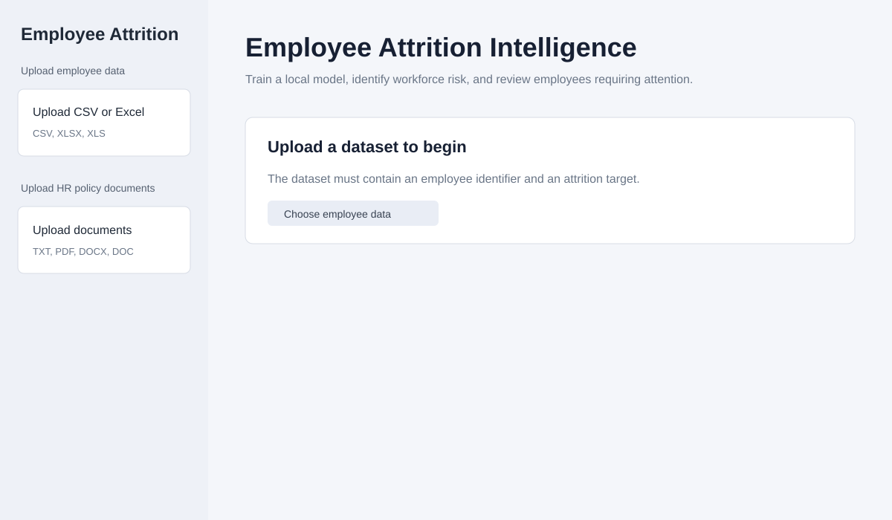
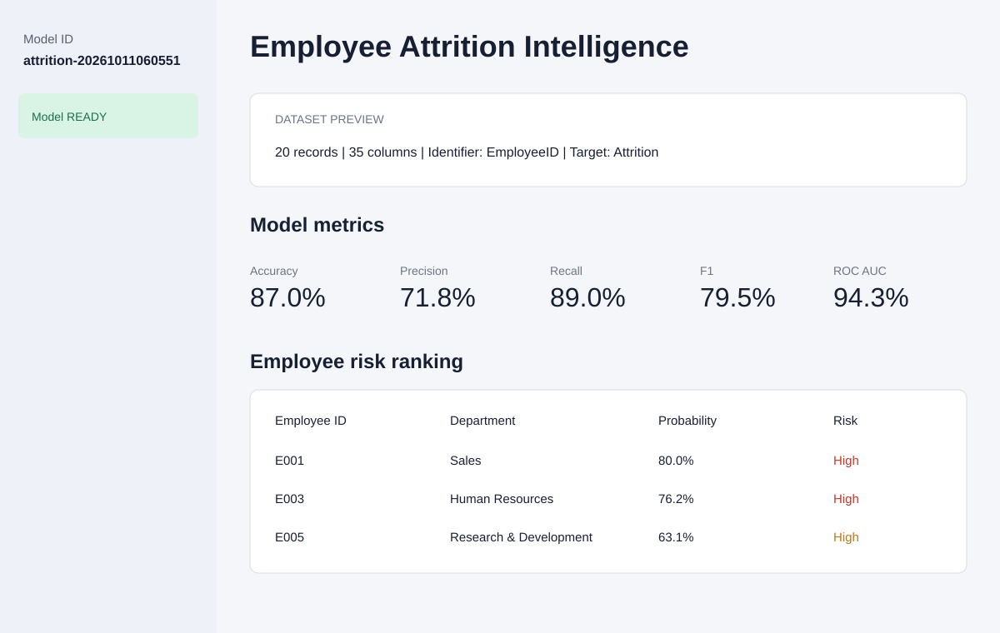
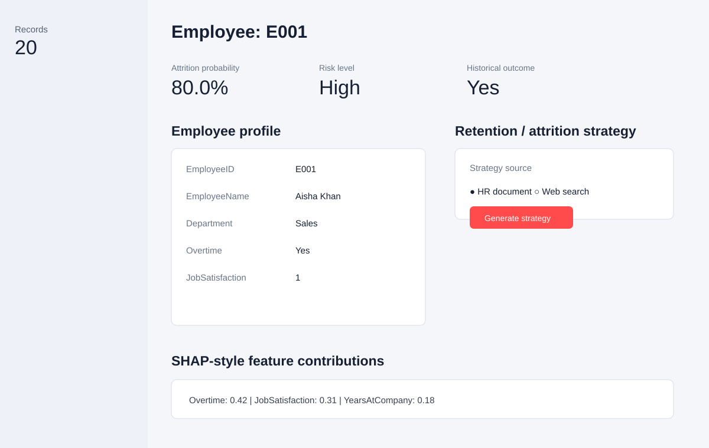

# Employee Attrition Intelligence

Streamlit application for training a local employee-attrition model, ranking workforce risk, explaining individual predictions, and generating retention guidance from HR documents or live web results.

## Features

- Upload employee data as CSV or Excel (`.csv`, `.xlsx`, `.xls`).
- Validate identifiers, attrition targets, row counts, duplicates, and empty data.
- Train and persist a stacked Random Forest/XGBoost ensemble with a logistic regression final estimator.
- Display accuracy, precision, recall, F1, and ROC-AUC metrics.
- Rank employees by predicted attrition probability and label them Low, Medium, or High risk.
- Inspect an individual employee profile and local SHAP-style feature contributions.
- Upload TXT, PDF, DOCX, or DOC HR documents for retrieval-assisted retention recommendations.
- Optionally retrieve a short live strategy summary through DuckDuckGo.

## Screenshots

### Upload and validation



### Risk dashboard



### Employee explanation and retention guidance



## Quick start

### 1. Create an environment

```powershell
py -3 -m venv .venv
.\.venv\Scripts\Activate.ps1
python -m pip install -r requirements.txt
```

### 2. Start the application

```powershell
streamlit run app.py
```

The application opens at `http://localhost:8501`.

### 3. Upload employee data

The dataset must contain:

- An employee identifier such as `EmployeeID`, `Employee ID`, `employee_id`, `EmployeeName`, or `Name`.
- An attrition target such as `Attrition`, `Turnover`, `LeftCompany`, or `Exited`.
- At least 20 rows for model training.

Common target values such as `Yes`/`No`, `True`/`False`, `1`/`0`, `Left`, and `Stayed` are normalized automatically.

After upload, select **Train / refresh model**. The trained model and preprocessor are saved locally under `models/` and are ignored by Git.

## Project layout

```text
app.py                         Streamlit user interface
config.py                      Paths and model settings
ml/                            Preprocessing, training, evaluation, prediction
explainability/                SHAP-style and LIME-style explanations
rag/                           Document loading, retrieval, recommendations
tests/                         Core pipeline and integration tests
docs/screenshots/              Application screenshots
```

## Tests

```powershell
pytest -q
```

## Notes

- The application does not commit uploaded employee data, databases, model binaries, secrets, or generated logs.
- Live strategy summaries require network access; HR document recommendations work locally after documents are uploaded.
- Attrition predictions are decision-support signals and should be reviewed by qualified HR professionals before action.